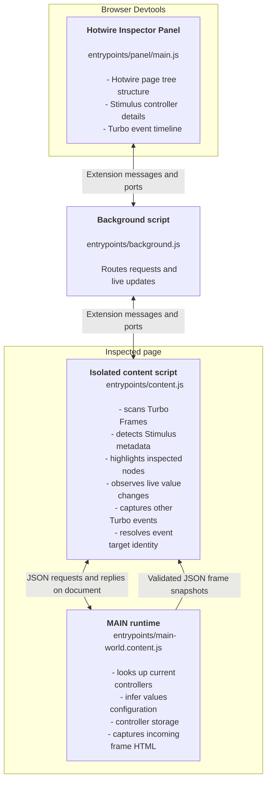

# Hotwire Inspector

Cross-browser DevTools extension for inspecting Hotwire applications. Built with WXT and Vite, with Vitest and Playwright for testing.

## Why Hotwire Inspector?

Hotwire Inspector exists to make it easier to understand the structure of Hotwire-powered pages, especially Turbo Frames and Stimulus controllers, directly from the browser's DevTools.

There are existing tools, but I wanted a cross-browser extension that integrates into DevTools rather than opening a separate window.

### Hotwire Inspector works hard to not interfere with your application

The inspector aims to keep the page close to its normal runtime behavior:

- Element tracking uses existing IDs and weak references, without adding tracking attributes to the DOM. The tracking maps do not keep detached elements alive.
- Highlighting adds a temporary, fixed-position overlay rather than changing the inspected element's styles.
- Turbo events are observed through capture-phase listeners. MAIN captures the events that have details that are invisible to the isolated script. The isolated script owns the other events and resolves element identity.
- Access to Stimulus controllers and their definitions happens on request. These queries create no page globals; The only globals created are those storing a controller in a `window.tempN` variable, at explicit user request.
- The browser loads the MAIN script directly, without inserting a script element into the page.

Inspection still runs code in the page's environment. Looking up controllers and reading metadata can invoke page-owned methods or getters.

## Architecture

The extension separates DOM inspection from access to the page's JavaScript objects. The isolated content script can read the DOM, but it cannot directly access the page's Stimulus application or live Turbo event objects. A small runtime in the page's **MAIN world** handles that access.



Panel actions travel through the background script to the content script as individual requests and replies. Live tree changes, value updates, and Turbo events travel back over long-lived ports. The content script asks MAIN for controller definitions or storage; current value attributes, target and outlet element matching, and live observation stay in the isolated script.

The browser registers the [MAIN entrypoint](entrypoints/main-world.content.js) directly, without injecting script elements. It handles inspection that needs access to page-owned JavaScript objects; DOM identity and extension messaging stay isolated.

Incoming frame HTML is captured as a snapshot and displayed as inert text. Oversized snapshots carry an omission message.

Page scripts can forge bridge messages. Validation checks their shape, not their authenticity. See [ADR 5](docs/decisions/5%20-%20shared%20MAIN%20world.md) for the rationale and tradeoffs.

## Local development with hot reloading

Use Node.js 22.13 or later. Install dependencies, then start WXT:

```bash
npm install
npm run dev
```

For Firefox, use:

```bash
npm run dev:firefox
```

WXT opens the browser, rebuilds the extension, and reloads it as you make changes. Navigate to an HTTP/HTTPS page, open DevTools, and select the `Hotwire Inspector` panel.

### Panel appearance

The panel follows the operating system color scheme by default. Use the theme switcher next to `Refresh` to choose `System`, `Light`, or `Dark`.

The selected mode is saved locally for the extension panel. It only changes Hotwire Inspector's DevTools UI and does not modify the inspected page.

### Testing from a dev container

If you are developing inside a dev container, the build and watch commands still run there, but there's no way for the script to launch a browser automatically. It's possible to develop from the devcontainer but it's less convenient than running it directly on the host machine.

These are the steps for it:

- run `npm run dev` or `npm run dev:firefox` inside the container to keep the extension rebuilding in watch mode
- load the extension manually in the browser running on your host machine from the appropriate `output/...` directory if needed
- expect to reload the extension manually in the host browser after changes instead of relying on full automatic hot reload
- refresh the inspected page or reopen the DevTools panel if the updated extension state is not picked up immediately

## Website

The single-page Jekyll website lives in `website/` and builds independently of the extension. See the [website README](website/README.md) for local development, devcontainer setup, production builds, and publication instructions.

## How E2E tests work

The default Playwright suite loads the built extension in Chromium. Because Playwright's bundled Chromium does not render custom DevTools panels, messaging and panel rendering are tested separately:

- [Content-script tests](tests/e2e/content-script.spec.js) send requests through the extension's DevTools frame and verify real scanning, highlighting, controller storage, definitions, and live updates.
- [Panel tests](tests/e2e/panel.spec.js) load `panel.html` as a standalone extension page with mocked browser APIs and assert on rendering and interaction.
- [MAIN boundary tests](tests/e2e/main-world-gate.spec.js) install a separate instrumented build to check communication across JavaScript worlds, both startup orders, BFCache restoration, and the absence of added scripts or unexpected globals.

These tests cover the UI and its underlying messaging, but do not automate a complete interaction through the browser's native DevTools panel. On Linux, the helpers start `Xvfb` when no display is available; the `Xvfb` executable must be installed.

Run unit tests with `npm test -- --run`. For E2E tests, build the extension first:

```bash
npm run build
npm run test:e2e
```

Firefox has a separate mocked-panel smoke test and an installed-extension MAIN boundary runner. See [tests/README.md](tests/README.md) for commands and browser-specific setup.

## Acknowledgements

- The extension icon is a color customized version of "Lightning spanner" icon from the [game-icons.net](https://game-icons.net/) project.
- The UI icons are from [heroicons.com](https://heroicons.com/).
